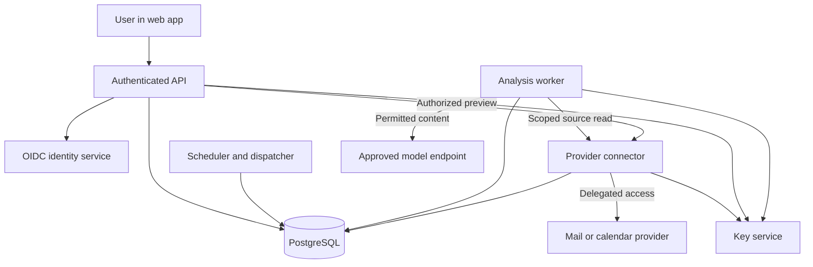

# Mail and Calendar Assistant Service Design and Architecture

[Source Page](https://chatgpt.com/space/page_863ccc5ffa608191b4d1939cb98db5f8). Snapshot of version 3, November 19, 2026. The source describes a proposed design.

**Version 3 · November 19, 2026 · Proposed design**

The first release answers two questions for a private user. What do I owe someone? What am I waiting for? It reads one mailbox, tracks each obligation, and produces two daily briefings. The user can correct the result and open the original message.

One portable backend owns execution and state. PostgreSQL holds application records and jobs. Separate processes handle provider credentials and private content analysis. Provider drafts enter the design in a second release, after the service demonstrates reliable detection, isolation, and recovery.

# Release scope

| Release | User capability | Entry condition |
| --- | --- | --- |
| 1 · Private read-only pilot | Connect one Gmail account. Read a private web briefing. Complete, ignore, reopen, or snooze an action. Receive an urgent notice in the web app. | A named operator has established account eligibility, processor terms, recovery targets, and access controls. |
| 2 · Requested replies | Request a reply for one thread. Review its sources and checked revision. Open the saved draft in the mail application. | The pilot meets its detection and usefulness targets. The connector passes the draft and recovery tests. |
| 3 · Calendar assistance | Connect selected calendars. Request time offers. Receive meeting preparation on the preceding working day. | The adapter can report coverage for each selected calendar and requested interval. |
| Later integrations | Add another provider, private research, Notion proposals, or another client through the same API. | Each feature has a named owner, demonstrated need, and a passing permission and recovery test. |

Gmail is the reference provider for this design. Pilot enrollment depends on the actual Google account and application status. Record the basis for any pilot exception. Public launch requires applicable verification and assessment. External testing status can cause mail refresh tokens to expire after seven days. Show reconnection as a coverage failure. [Google restricted scopes](https://developers.google.com/identity/protocols/oauth2/production-readiness/restricted-scope-verification) · [Google OAuth token expiry](https://developers.google.com/identity/protocols/oauth2)

Sending, forwarding, deleting mail, changing mail rules, and changing calendars are outside the service contract. The user sends from the native mail application. Label changes and Notion writes require separate release decisions. Phone and Dot clients can use the same authenticated API later.

# Application and trust boundaries

Deploy one Python codebase with FastAPI, typed request schemas, SQLAlchemy, psycopg, Alembic, and Procrastinate. Run Linux containers behind an HTTPS reverse proxy. Use private networking and separate runtime identities. PostgreSQL provides the queue. The pilot runs on a Linux host with an independently recoverable backup and revocation ledger. Use TLS on internal links and authenticate service identities.

| Process | Permitted access |
| --- | --- |
| API | Authenticate users. Read authorized results. Accept local actions and draft requests. Decrypt derived content. Request transient previews through the connector. |
| Scheduler and dispatcher | Read due times and control fields. Create jobs and bind attempts to authorized work. No content decryption or provider network access. |
| Connector | Check attempt authority. Decrypt credentials for the assigned connection. Read authorized sources. Execute enabled provider operations. Network access covers configured providers and internal dependencies. |
| Analysis worker | Claim assigned analysis work. Request scoped content from the connector. Use the approved model endpoint. Write permitted derived results. Its identity cannot change grants, approvals, or ownership. |
| Identity and key services | The identity service authenticates people. The key service authorizes key operations by runtime identity and key purpose. Each has its own credentials and recovery procedure. |

Treat mail, calendar entries, attachments, and model output as untrusted input. Their content cannot authorize a tool call, new recipient, source lookup, or disclosure. Expose typed operations to models. Enforce each permission in service code. A privileged host can observe plaintext during authorized processing.

Use Keycloak and OpenBao Transit as the reference deployment. An existing OIDC or key service can fill the same role after it passes the same tests. The operator owns patching, signing-key protection, unseal or recovery access, and restore drills. Keep bootstrap secrets and recovery credentials outside application backups. [Keycloak features](https://www.keycloak.org/server/features) · [OpenBao Transit](https://openbao.org/docs/secrets/transit/)

# Identity and permission

Each user owns a private tenant. The API maps the verified OIDC issuer and subject to that tenant. Browser sign-in uses authorization code with PKCE, exact redirects, state and nonce, secure HTTP-only cookies, and CSRF protection. Require verified passkeys or password plus MFA. Require fresh authentication for account recovery, credential changes, and account deletion. Use separate administrator identities with phishing-resistant MFA. [OAuth security guidance](https://www.rfc-editor.org/rfc/rfc9700.html)

Bind provider consent to the signed-in user and connection attempt. Before collection, show the purpose, processors, retention period, and requested permissions. Record affirmative consent, its policy version, the stable provider account ID, granted scopes, grant ID, and connection epoch. Reconnecting a different mailbox requires an explicit replacement. A grant can serve multiple features. Before revocation, show all affected connections. For Google, revocation can invalidate credentials across clients in the same project for that user. [Google token revocation](https://developers.google.com/identity/protocols/oauth2/web-server#tokenrevoke)

The dispatcher derives tenant, connection, purpose, source scope, audience, expiry, and epoch from trusted records. It binds them to a worker attempt. The connector resolves and checks that binding for every source read or write. A job ID, model response, client parameter, or message header grants no access.

Use tenant-scoped foreign keys and uniqueness constraints. Apply row-level security to business tables. Keep runtime roles separate from table owners and migration roles. Derive transaction-local scope from an authenticated session or a claimed attempt. Give workers scoped claim and result operations. A worker must have no path to select another tenant by setting a session variable. Test effective database permissions with the actual service identities. [PostgreSQL row security](https://www.postgresql.org/docs/current/ddl-rowsecurity.html)

Logging out ends the current app session. Device revocation ends sessions for that device. Account recovery invalidates previous app sessions and requires fresh sign-in. A mailbox grant continues scheduled work until pause, disconnect, expiry, or revocation. Display this distinction at sign-out and in connection settings. Check server-side session state before protected operations.

# Information model and user behavior

| Record | Identity and purpose |
| --- | --- |
| Source reference | Connection, provider object ID, folder or collection where required, observed version, and checked time. |
| Action | Stable local ID, owner, category, status, explicit deadline, inferred follow-up, next check, version, and evidence references. |
| Reply | One thread, sending account, intended recipients, one or more action IDs, candidate revision, and review state. |
| Derived item | Tenant, account, source dependencies, permitted audience, expiry, and authorized fields. Includes evidence, preferences, and briefings. |
| Execution record | Job, attempt, access epoch, spending reservation, and outcome. External operations also have a request fingerprint and reconciliation state. |

Use Decide, Reply, Wait, and Nothing as triage categories. Nothing records a classification and creates no open obligation. Keep status, category, and reply review state separate. Preserve user corrections across repeated analysis. On first discovery, assign a local action ID and bind it to the source message, obligation type, and participant reference. Compare new evidence with open actions and prior user decisions in that thread. If a match is ambiguous, request a user decision. An inaccessible source leaves its action unresolved.

For example, one message asks for a price and a delivery date. Create two actions. One reply can address both. If a later message supplies only the price, close only that action. Record the evidence for closure. New evidence can reopen an action. Reprocessing unchanged evidence cannot reverse a user decision.

Show source coverage first when it is incomplete. Then show decisions, replies, overdue promises, and due follow-ups. Start with five ordinary decisions. Group additional due items with their count and earliest deadline. Each item remains accessible. Deduplicate urgent notices by action, due time, and material change. Schedule known due items even during a provider outage.

Web notices are visible while the app is open and remain available at the next sign-in. The pilot makes no urgent delivery commitment to offline users. A later phone notice contains generic attention text and an opaque reference.

Use the user’s workweek, holidays, briefing times, and IANA time zone. Store exact instants in UTC. Preserve date-only deadlines and the source time zone. Ask about ambiguous deadlines. For a repeated local briefing time, deliver once. For a skipped time, use the next valid local time. After an outage, deliver one current catch-up briefing.

# Synchronization and job execution

1. At connection time, show the folders, labels, and historical interval the service will cover. Include the Sent scope needed to detect fulfilled promises. Store that scope with the checkpoint. Show any excluded period in the briefing.

2. Start with five-minute polling. Spread poll times across accounts. Coalesce repeated triggers into one active synchronization and one pending pass per connection.

3. For each page, commit source references, pending analysis work, and the next cursor in one database transaction. Promote the completed checkpoint only after the full pass. Reconcile changes that arrived during the initial scan.

4. On an expired cursor, start a full synchronization of the declared scope in bounded batches. Mark coverage incomplete until the scan catches up. Resume known actions from their own schedule. [Gmail synchronization](https://developers.google.com/workspace/gmail/api/guides/sync)

5. Process a new content revision once per applicable analysis policy version. Distinguish content changes from folder moves, label changes, and service-created drafts. A service-created draft alone cannot start another reply.

6. Claim each job in a short transaction. Release the transaction before network calls. Commit results and follow-up jobs together. A stale attempt cannot commit after a newer attempt takes ownership.

Use the same physical database connection for business changes and transactional enqueue. Pin a supported driver combination. With psycopg 3, pass the supported driver connection to Procrastinate. A rollback test must remove both records through the normal application entry point. [Procrastinate external transactions](https://procrastinate.readthedocs.io/en/stable/howto/production/external_connection.html)

Jobs run at least once. Retry transient reads with bounded backoff. Reconcile interrupted writes before another attempt. Reserve worker slots, database connections, provider capacity, and model budget for due work. Respect provider retry delays. Show source lag, analysis backlog, and notification failure separately. [Procrastinate worker recovery](https://procrastinate.readthedocs.io/en/stable/howto/production/retry_stalled_jobs.html) · [Gmail quota limits](https://developers.google.com/workspace/gmail/api/reference/quota)

# Content handling and retention

Mail bodies, quoted threads, prompts, attachment bytes, and full draft text exist only in memory inside the service. Provider Drafts holds a complete saved reply. Jobs carry references and small control fields. Disable content capture in logs, traces, SDKs, proxies, caches, swap, temporary files, and crash dumps. Preview responses use `Cache-Control: no-store`. Show plain text by default and suppress remote resources.

For the pilot, persist structured action facts, dates, status, and provider references. Generate descriptive text for the authenticated view from the current source when needed. If the source is unavailable, show the saved facts and their checked time. Omit open-ended generated summaries from pilot storage. Later free-text fields require a retention review across the whole record. A short complete message still falls under the body-storage rule.

Every derived item inherits its source restrictions. Read access and permission to disclose are separate. Restrict pilot items to one account and one private audience. On permission loss, immediately hide dependent results from views, exports, previews, and notifications. Rebuild or purge them from recorded dependencies. Cross-account calendar use requires an explicit mapping.

Encrypt derived content and provider credentials with separate wrapping keys and decryption policies. Bind ciphertext to tenant, connection, record, and purpose. Keep opaque IDs, status, due times, and queue indexes queryable. Database backups can reveal timing and relationships through those fields. Restrict backup access. Track wrapping-key and fingerprint-key versions through rotation and backup expiry.

| Data | Default retention |
| --- | --- |
| Briefing records and permitted standalone summaries | 30 days. The pilot stores references and structured facts. |
| Open actions and active preferences | While needed. Flag actions without new evidence for 90 days. Ask the user to keep or close them. Publish the paused-account expiry before enrollment. |
| Closed or ignored actions and evidence | 90 days after closure. |
| Completed operations, jobs, and operational logs | 30 days. Retain a minimal receipt for an unresolved effect until resolution or explicit abandonment. |
| Content-free security audit | 180 days with restricted access. |
| Encrypted backups and archived database logs | Rolling 35 days. |

Pause stops new work and retains account data. Disconnect closes admission, increments the epoch, cancels queued work, and starts provider revocation and purge. Delete live credentials and connection-derived data within 24 hours. Account deletion covers every connection and remaining user content. Protected backups can retain deleted data for up to 36 days from the request. Original provider mail and drafts remain under user control.

# Provider operations and recovery

Admission and disconnect lock the same connection record. For each provider request, model disclosure, or notification, check the grant and record admission in one short transaction. Disconnect blocks new admissions immediately. A previously admitted request can finish after disconnect. Discard its derived result after the epoch changes. Keep only the permitted operational receipt.

For a write, persist the operation ID, caller, target, expected version, fingerprint, and intended effect before dispatch. A successful response records the provider reference. A lost response enters **uncertain**. Use documented provider evidence to identify the effect. Two matching bodies do not establish identity. If the evidence is insufficient, block automatic retry and ask the user to resolve the operation.

Restore with dispatch disabled and provider credentials inaccessible to workers. Apply a current deletion and revocation ledger kept outside the restore boundary. Invalidate uncertain sessions and approvals. Treat all effects in the rollback interval as uncertain, including effects absent from the restored database. If independent records cannot establish that interval, suspend affected writes and require new user decisions. Resume reads first, then eligible writes. Test recovery across a key rotation.

# Reply review and the first provider write

The user requests a reply for one thread and selects the relevant actions. The service resolves the sending identity, recipients, source scope, and destination. Treat shared mailboxes and delegate-visible Drafts as distinct audiences. If the destination audience is uncertain, keep the preview private. Request write scope only after the feature is enabled. Gmail compose grants can also authorize sending. Restrict the connector to its published operations. [Gmail authorization scopes](https://developers.google.com/workspace/gmail/api/auth/scopes)

The writer receives only sources permitted for that audience. The reviewer receives the actual candidate, original request, permitted evidence, and checklist in a fresh context. Check the recipients, unanswered questions, commitments, factual claims, and freshness of required sources. Allow one revision and one further check. A failed review, unavailable source, timeout, or exhausted budget leaves the draft blocked.

Keep the candidate in memory through review and creation. If text is lost, generate and review a new candidate. After creation, read back the provider revision. Compare sending identity, To/Cc/Bcc, subject, body, attachment manifest, and relevant source versions using a versioned fingerprint. Record the review time only for a matching revision. Gmail retains the draft container ID when the underlying message changes. [Gmail draft behavior](https://developers.google.com/workspace/gmail/api/guides/drafts)

Display **Reviewed at** with the time and revision. A changed or inaccessible revision loses that status. Preserve human edits. Use atomic conditional updates only where the adapter has demonstrated them. Otherwise offer a separate candidate with explicit user consent. Keep one current reply reference for the selected actions. Show superseded drafts for manual cleanup. The native mail client controls edits and sending after the last check.

# API and operations

Publish a versioned OpenAPI contract for sessions, connections, coverage, briefings, actions, replies, and operations. Local actions support complete, ignore, reopen, snooze, and version-checked undo. Protected reads check ownership and audience. State changes require authenticated commands. Opening a link has no side effect.

Bind each retry key to the caller, operation, target, and request fingerprint. Return the previous receipt for an identical retry. Reject changed input under the same key. For an approved external effect, consume the approval, create the operation, and enqueue its work in one transaction. Store permitted receipts for transient edits without retaining the edited text.

Reserve a maximum cost before each paid call. Enforce item, user, and service ceilings. If a charge is uncertain, retain the reservation until billing reconciliation or documented settlement. Service-wide controls can stop model disclosure and provider writes independently. Keep the scheduler and existing due-item views available during either stop.

Operators see operational metadata by default. Exceptional content access requires an authorized purpose, applicable user consent or other permitted basis, narrow scope, expiry, and audit. Record source access, processor use, changes to grants, external effects, exports, and deletion. Keep queries, prompts, addresses, and content out of ordinary telemetry.

# Calendar and later provider contracts

Use free/busy data for availability wherever it meets the user’s request. Offer a definite time only when all selected calendars cover the interval. Apply working hours, buffers, and focus periods. Preserve all-day local dates and recurrence exceptions. Treat missing coverage as unknown. If only busy intervals are available, use the provider’s result. Detailed invitation rules require event access. [Google free/busy response](https://developers.google.com/workspace/calendar/api/v3/reference/freebusy/query)

For authorized event detail, busy and out-of-office events block time. Free, canceled, and declined events do not block. Tentative events block by default unless explicitly free. Working elsewhere alone does not establish a conflict. Recheck time offers before saving a draft. Only scheduling replies depend on calendar coverage. Prepare meeting briefs on the preceding configured working day. A late change triggers a new check.

| Feature | Condition for implementation |
| --- | --- |
| Microsoft Graph | Track message deltas per folder. Use immutable IDs where supported. Handle archive-mailbox moves explicitly. Check calendar features by account type. Delegated personal accounts cannot use `getSchedule`. [Message delta](https://learn.microsoft.com/en-us/graph/delta-query-messages) · [Immutable IDs](https://learn.microsoft.com/en-us/graph/outlook-immutable-id) · [Calendar availability](https://learn.microsoft.com/en-us/graph/api/calendar-getschedule?view=graph-rest-1.0) |
| Notion | Start with selected resources and read-only proposals. Show workspace, parent, audience, exact patch, expected version, and expiry. Permit creation only with single-use approval and a defined recovery path. Existing-value edits need demonstrated atomic protection. Otherwise the user applies them manually. [Notion capabilities](https://developers.notion.com/reference/capabilities) |
| Labels and push | Allow explicit application-owned label IDs on specified messages only. Keep system labels unavailable. Authenticated push can wake synchronization. Continue periodic reconciliation. [Gmail labels](https://developers.google.com/workspace/gmail/api/guides/labels) · [Gmail push](https://developers.google.com/workspace/gmail/api/guides/push) |
| Public research and attachments | Give the public fetcher a separate identity, approved destinations, bounded requests, and no private database or credentials. Build queries from approved public fields. Run attachment parsers without network access or credentials. |
| iCloud and Proton | Check authentication, scope, and calendar behavior before enrollment. Proton requires a local companion and an explicit decision about the Bridge cache. IMAP references include the connection, mailbox, UIDVALIDITY, and UID. [Proton Bridge cache](https://proton.me/support/comprehensive-guide-to-bridge-settings) |

# Release evidence and ownership

Use these proposed targets for the read-only pilot. Surface 95 percent of known due actions within ten minutes of their due time while the service is available. During an operating drill, restore read access within four hours with at most 15 minutes of lost application updates. Revocations and deletion records must survive the restore. Any loss of authority records keeps dispatch closed. Publish actual results beside the targets.

The service owner records the pilot cohort, provider scopes, source window, inactivity periods, numeric targets, and named operators before enrollment. The privacy owner records processor, endpoint, feature, account settings, permitted audience, review date, and expiry. An expired or unknown approval closes that route. Exclude known regulated clinical workloads until the necessary agreements and controls exist. [Google Workspace data policy](https://developers.google.com/workspace/workspace-api-user-data-developer-policy) · [Model endpoint data controls](https://developers.openai.com/api/docs/guides/your-data)

| Gate | Evidence required to pass |
| --- | --- |
| Private pilot admission | Tenant A cannot read, claim, decrypt, or change tenant B’s records. An analysis worker cannot widen scope. Withdrawal of access hides all dependent items. Synthetic marker text stays out of every durable service destination. |
| Detection and usefulness | Independently sample the declared mailbox scope. Trace each sampled obligation from discovery to briefing. Count missed actions, false closures, useful alerts, and net time saved after corrections. Keep tuning and evaluation samples separate. |
| Scheduling and recovery | A known obligation appears without new mail. A crash on the last sync page loses no work. A flooded mailbox respects other users’ capacity. A restore preserves deletion and revocation. Measure lag, data loss, and recovery time against declared targets. |
| Draft release | A changed recipient or human edit invalidates review. A reviewer timeout creates no provider draft. A lost creation response cannot trigger an automatic duplicate. A restore after creation cannot replay the approval. |
| Additional integrations | Demonstrate permission limits, loss of coverage, grant revocation, and provider-specific failure recovery. Add an independent authorization review before opening the service to unrelated users. |

Version each model, prompt, tool schema, policy, and fingerprint format. Use fixed model revisions where available. Use synthetic fixtures for repeatable tests. Mark historical cases unevaluable when an earlier source version is unavailable. Run a read-only shadow period before promotion. The release owner records results, sample sizes, acceptance thresholds, and the rollback decision.
